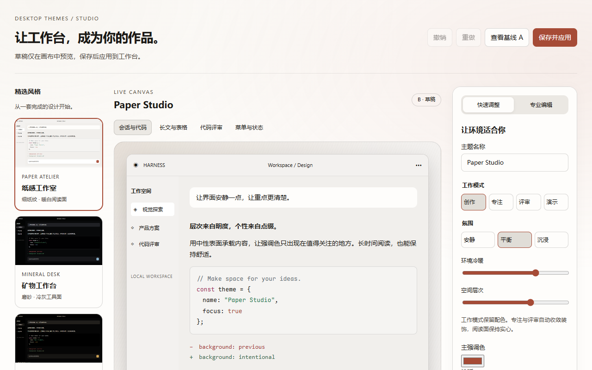
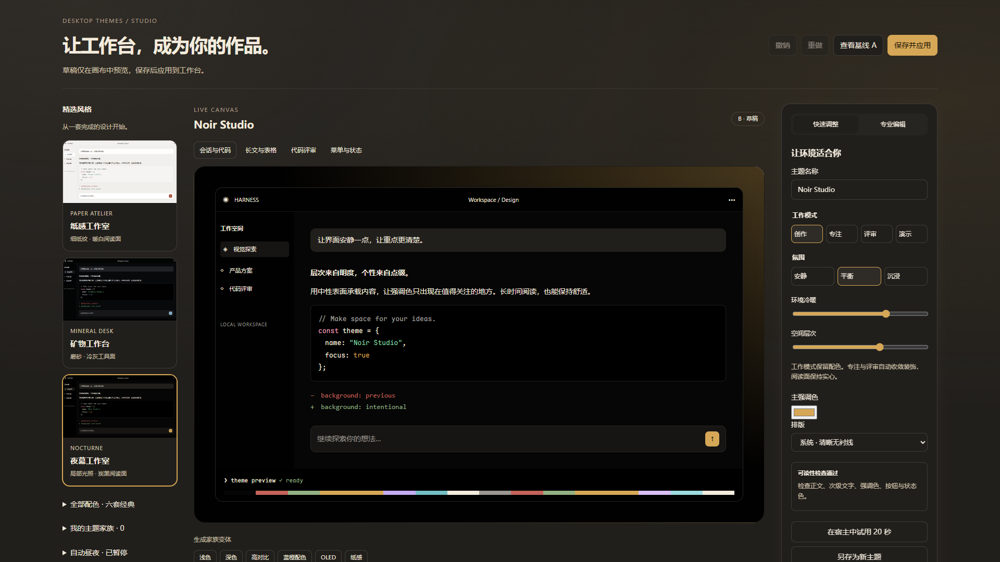
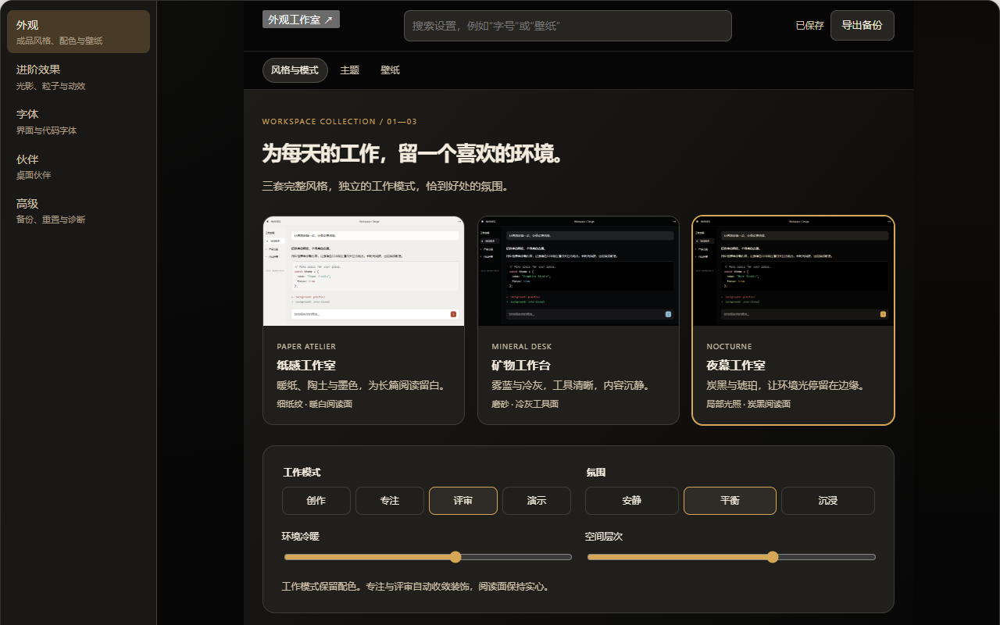

# DeepSeek Harness Desktop Themes

**3.0 工作环境改版：[使用与覆盖范围](docs/workspace.md)**。纸感工作室、矿物工作台、夜幕工作室三套成品风格；创作/专注/评审/演示模式独立于配色，安静/平衡/沉浸独立控制装饰。

面向 **DeepSeek Harness Desktop** 的可安装工作环境插件。默认以静态材质、环境色和稳定阅读面建立层次；原有六套配色与专业调色能力保留。工作室新增快速/专业编辑、本地壁纸取色、四类内容预览、20 秒宿主试用、精选社区配色、携带壁纸的风格包与 PNG 分享卡。新用户桌宠默认关闭。

- 平台：**DSH Desktop（Electron）**；宿主进程侧负责配置持久化。Web profile 仍可加载同一构建，但 2.0 起只保证桌面端体验
- 技术：TypeScript + React（客户端）+ Cordis（DSH 插件运行时）
- 依赖零额外运行时库（仅 `@deepseek-ai/schemastery` 用于宿主侧 schema）

> 本插件只使用 DeepSeek Harness **真实存在的插件接口**（`theme` 服务、`settingsScope`、`slots`、`cordis.patch.yml` 组合层），不修改任何宿主核心文件，卸载即恢复。

---

## 目录

1. [效果对比](#效果对比)
2. [功能](#功能)
3. [快速开始（构建）](#快速开始构建)
4. [让 AI 一键安装](#让-ai-一键安装)
5. [手动安装](#手动安装)
6. [卸载与恢复](#卸载与恢复)
7. [配置与持久化](#配置与持久化)
8. [字体安装与回退](#字体安装与回退)
9. [性能模式](#性能模式)
10. [测试与构建验证](#测试与构建验证)
11. [已知限制](#已知限制)
12. [项目结构](#项目结构)
13. [分阶段路线图](#分阶段路线图)

---

## 效果对比

以下为 3.0 工作室和真实客户端入口的服务适配器验收截图。缩略图由实际预览组件截取；不代表宿主所有页面均已验收。

| 纸感工作室 | 夜幕工作室 |
| --- | --- |
|  |  |



旧版截图保留在 docs/screenshots/，不作为当前效果展示。

---

## 功能

| 分组 | 能力 |
|---|---|
| 工作室与分享 | 快速/专业编辑、四类内容预览、20 秒临时试用；本地壁纸生成配色；完整风格包、PNG 预览卡、精选社区配色 |
| 风格与模式 | **纸感 / 矿物 / 夜幕** 三套成品风格；创作/专注/评审/演示模式保留配色；安静/平衡/沉浸调整氛围。冷暖、空间层次可独立调整 |
| 主题风格 | 六套高级配色：**Paper、Mist、Graphite**（工作台）与 **Arc、Dune、Noir**（电影感）；可视化主题卡片 + 可读性徽标；**默认只换配色**，可选「整套氛围」；按住空格预览、松手/Esc 取消、点击/回车应用；8 秒内可撤销 |
| 字体排版 | 界面/代码字体独立下拉，预设 9+8 组，每个选项用对应字体渲染预览并显示“系统已安装 / 插件内 / 可下载 / 回退”；**7 款主流字体一键下载到插件内**（IndexedDB + FontFace，离线可用、不改系统）；中英文家族名自动别名匹配；字号、行高、字重、连字、平滑 |
| 壁纸 | 六套主题各有专属内置壁纸；本地选择 + 拖放 + 最近使用 + 预览；填充/适应/居中/拉伸/平铺；缩放/透明度/模糊/亮度/饱和度/暗色遮罩/主题色混合；**首屏安全区**（中心暗角 + 底部/侧边 scrim）；加载失败显示空状态；自定义壁纸 **IndexedDB 持久化** |
| 桌面小人 | 月灵狐单角色；无底图分层轮廓，随机眨眼、颈部轴心摇头、尾根轴心摆尾、惯性回弹与持续呼吸；发声提供正常/温柔/欢快/俏皮/沉稳/机器人 6 种语调；可拖拽定位、单击打开快捷菜单 |
| 光影效果 | 光影强度（关闭/柔和/标准/明亮）、光标跟随柔光、背景视差、柔光呼吸 |
| 粒子效果 | 十种预设（科技数据流、星空、极光、萤火、气泡、樱花、金尘、呼吸…）；密度/数量/大小/速度/透明度/连线/鼠标互动/自动配色 |
| 透明与毛玻璃 | 窗口/侧边栏/面板/输入区透明度（0.55 下限）；模糊强度（关闭/轻度/标准/强烈）+ 降级 |
| 内容区样式 | Diff 行高亮采用「行号标记条 + 极淡行底色」，新增/删除按主题成功色与危险色派生；六套主题均支持「经典/焕新」切换和完整强度滑杆。代码块使用按主题校正对比度的 Shiki 语法色，设置页可同时预览代码与 diff。|
| 阅读与氛围 | 模式与氛围独立选择；专注与评审自动收敛装饰，阅读面保持实心。|
| 自定义配色 | 七色自定义主题；一键生成 7 种协调配色；**WCAG AA 可读性门禁**（正文 ≥4.5:1、界面 ≥3:1）+ 具体色对提示与一键修正；命名/保存/复制/删除；内置主题不可破坏、可复制后编辑 |
| 动画与性能 | 动画速度（静止/舒缓/标准/活跃）；性能等级（省电/均衡/高质量）；输入/流式输出时粒子自动降到 15 FPS 并跳过连线 |
| 设置体验 | 5 组导航（外观/进阶效果/字体/伙伴/高级）；搜索设置并跳转；自动保存状态；每个控件可单独恢复默认；导入导出与诊断 |
| 导入导出 | JSON 导出/导入（schema 校验 + 版本迁移）；顶部“导出备份”；分组/当前主题/全部默认值重置 |
| 可访问性 | `prefers-reduced-motion`、`prefers-reduced-transparency` 友好；Toggle 使用本地化开/关；tablist 支持方向键/Home/End；桌宠菜单有焦点陷阱与 Esc 归还焦点 |
| 表面层级 | 左右栏 chrome 与中间画布分离；面板/输入/浮层按明度分层；边框、阴影与 `--dsw-elevation-*` 随主题重算，`npm run audit:surfaces` 门禁 |

设置页即时应用并自动保存，工作室编辑先留在草稿、顶部保存后应用。默认 Paper 纸感环境使用静态材质与轻环境色，不启动持续装饰动画。桌宠为可选伙伴，已有用户开关保留。完整风格包包含壁纸资源，全部设置 JSON 备份不包含图片字节。

---

## 快速开始（构建）

前置：Node.js ≥ 20（已在 Node 24 验证）、npm。

```bash
cd dsh-desktop-themes
npm install
npm run build        # 生成 lib/index.js 与 lib/client.js
npm run typecheck    # 严格类型检查（无 emit）
npm test             # 单元测试
npm run audit:contrast   # WCAG AA 对比度门禁（六套内置主题）
npm run audit:surfaces   # 左右栏 / 画布 / 面板 / 边框层级门禁
npm run audit            # 两个门禁一起跑
npm run bench        # 可复现的性能微基准
```

构建产物：

- `lib/index.js` — 宿主入口（注册 `ui-desktop-themes` 设置命名空间）
- `lib/client.js` — 客户端 bundle（`window.__ModuleLoader__.load` 包装）

生成可安装包：

```bash
npm pack            # 产出 dsh-desktop-themes-3.0.0.tgz
npm run install:desktop   # 直接把 lib/*、package.json 写入 ~/.dsh/profiles/desktop
```

> 2.0 起只保证桌面端。`install:desktop` 会复制构建产物并校验哈希，之后仍需**完全退出并重新打开 DSH Desktop**，宿主 schema 与客户端 bundle 才会重新加载。

---

## 让 AI 一键安装

把下面整段提示词复制给能操作终端和本地文件的 AI（例如 Codex）。AI 会自动识别系统、安装或更新插件、配置字体，并在最后验证结果：

```text
请直接在我的电脑上安装或更新 DeepSeek Harness Desktop Themes，不要只告诉我操作步骤；请持续执行到验证成功。

仓库：https://github.com/liu-zhexi/deepseek-harness-desktop-themes

要求：
1. 识别 Windows、macOS 或 Linux，以及现有 Git、Node.js、npm、pnpm、dsh 环境。Node.js 要求 >= 20；缺少必要工具时，只从官方来源或 npm 安装稳定版本。需要管理员权限时向我请求授权。
2. 将仓库克隆到合适的本地目录；如果已经存在，就安全更新到 origin/main。保留任何未提交的本地修改，不得强制覆盖或删除用户文件。
3. 安装依赖并依次执行 npm run typecheck、npm test、npm run build；遇到错误要定位并解决，不要跳过验证。
4. 推荐并安装两款字体：界面字体 LXGW WenKai（霞鹜文楷）和代码字体 Maple Mono。只能从各自官方 GitHub Release 下载字体文件，不要使用第三方镜像或不明安装器：
   - https://github.com/lxgw/LxgwWenKai/releases/latest
   - https://github.com/subframe7536/maple-font/releases/latest
   优先使用静态 TTF，安装到当前用户字体目录；安装后确认系统可以识别 “LXGW WenKai” 和 “Maple Mono”。
5. 确认 DeepSeek Harness Desktop 的 desktop profile 已初始化。插件包自带组合层，不要手动向 profile 的 cordis.patch.yml 添加 desktop-themes 行；若已有旧版手工行，先备份并移除该行。
6. 在仓库目录运行 npm run build && npm run install:desktop，把构建产物写入 desktop profile；随后完全退出并重新打开 DSH Desktop。
7. 验证桌面端“设置 → 桌面外观”出现，默认进入“风格与模式”并看到 Paper 工作台；然后将界面字体设为 LXGW WenKai、代码字体设为 Maple Mono；如果不能自动操作界面，明确告诉我最后两次点击的位置。
8. 最后汇报仓库路径、插件版本、构建/测试结果、字体安装状态、备份文件位置和访问地址。不得输出或上传本机密钥、照片及其他隐私文件。
```

> 推荐组合：**LXGW WenKai 用于界面与中文正文，Maple Mono 用于代码**。插件不内置字体文件，字体需要单独安装。

---

## 手动安装

插件由 **宿主侧（设置持久化）+ 客户端侧（主题/外观/设置页）** 组成。安装包声明了 `dsh.bundle`，会自动注册插件行。

### 1. 安装依赖包

```bash
# 安装构建好的 tgz（推荐，桌面端插件管理器也可选择此文件）
dsh plugin --profile desktop add file:D:/path/to/dsh-desktop-themes-3.0.0.tgz

# 或从 npm 安装（若已发布）
dsh plugin --profile desktop add dsh-desktop-themes
```

从 GitHub 源码地址直接安装时，包的 `prepare` 脚本需要在安装端获准执行构建；若插件管理器不支持允许构建脚本，请使用预构建的 `.tgz` 包。旧版手工写入 profile `cordis.patch.yml` 的 `desktop-themes` 行应在升级前备份并移除，避免重复挂载。

### 2. 重启

完全退出 DSH Desktop，再重新打开（不是刷新页面）。

重启后打开“设置 → 桌面外观”，默认进入“风格与模式”。完整说明见 [`docs/install.md`](docs/install.md)。

### 本地开发更新（推荐）

```bash
npm run build && npm run install:desktop
```

该命令直接复制 `lib/client.js`、`lib/index.js` 与 `package.json`，并逐文件校验 SHA-256，避免 `file:` 同版本缓存造成“代码已改但界面没变化”。完成后仍需重启桌面端。旧 Web 开发流程 `npm run deploy:web` 仅为兼容保留。

---

## 卸载与恢复

卸载即恢复原始外观——插件没有修改任何宿主文件，所有副作用（主题注册、样式注入、透明度 token 层、粒子 Canvas、设置命名空间）都随插件 fiber 的 dispose 释放。

```bash
# 1. 移除插件及其组合层
dsh plugin --profile desktop remove dsh-desktop-themes
# 2. 完全退出并重新打开 DSH Desktop
```

如需同时清空设置，删除 `$DSH_HOME/settings.yaml` 的 `ui-desktop-themes:` 分节，在桌面端清理 `dsh-desktop-themes` 的 IndexedDB（壁纸 blob 所在处），并删除 localStorage 中的 `dsh-desktop-themes:explicit-config:v4`（旧 v3 key 也会被读取）。

---

## 配置与持久化

**保存位置**（按优先级）：

1. 设置变更 → 350ms 防抖写入宿主设置 API，同时写一份不含图片字节的本地快照；顶部显示“保存中 / 已自动保存 / 保存失败（重试）”。刷新时优先恢复本地快照。
2. 顶部“导出备份”或高级页“导出设置 JSON” → 下载 `dsh-desktop-themes.json`，用于跨机器迁移；不再需要手动“保存全部设置”。
3. 自定义壁纸字节 → IndexedDB 数据库 `dsh-desktop-themes`（存 Blob，**不把 Base64 塞进 localStorage**）；六张内置主题壁纸随插件压缩发布，配置只保存 `builtin:<theme-id>`。

**可靠性**：

- 所有配置带 `schemaVersion`（当前 `3`），读取时做版本迁移（v1 → v2 → v3）。
- 配置校验：每个字段都是全函数（非法值回退默认，绝不抛异常、绝不产生半成品对象）。
- 写入采用防抖（350ms），滑块连续拖动不会高频写盘。
- 初始化先读配置再渲染外观，避免默认主题闪烁；刷新不重写默认设置。
- 数据损坏时自动回退默认值（`coerceConfig` 永不抛异常）。
- 设置页支持逐控件“恢复默认”、分组重置与全部重置；主题切换后可撤销 8 秒。

导入/导出为 JSON（`dsh-desktop-themes.json`），支持“恢复当前主题默认值 / 恢复分组默认值 / 恢复全部默认值”；全部重置会恢复 Paper 纸感工作台、内置矢量壁纸，并关闭可选桌宠。

导出/导入详情见 [`docs/configuration.md`](docs/configuration.md)。

---

## 字体安装与回退

### 一键下载（推荐）

设置 → 桌面外观 → 字体 → 界面/代码字体 中，7 款字体带有「下载到插件」按钮：

| 字体 | 用途 | 体积 | 许可 |
|---|---|---|---|
| LXGW WenKai（霞鹜文楷） | 界面 / 中文正文 | 7.2 MB | OFL-1.1 |
| Maple Mono | 界面 / 代码 | 131 KB | OFL-1.1 |
| JetBrains Mono | 代码 | 21 KB | OFL-1.1 |
| Cascadia Code | 代码 | 29 KB | OFL-1.1 |
| Fira Code | 代码 | 23 KB | OFL-1.1 |
| Source Code Pro | 代码 | 12 KB | OFL-1.1 |
| IBM Plex Mono | 代码 | 15 KB | OFL-1.1 |

字体字节存进插件自己的 IndexedDB（`dsh-desktop-themes-fonts`），通过浏览器 `FontFace` 注册，**不修改系统字体目录**；下载完成后自动应用，重启与离线仍可用。下载有进度、可取消、可移除；失败会给出网络 / HTTP / 配额 / 校验 / 浏览器不支持的明确原因。

> 下载源为官方项目或其 Fontsource 镜像（jsDelivr，CORS 已开启）；插件本身不打包字体文件。

### 系统安装（可选）

如果希望其他应用也使用同一字体，可按官方 Release 手动安装：

- **[LXGW WenKai（霞鹜文楷）](https://github.com/lxgw/LxgwWenKai/releases/latest)**
- **[Maple Mono](https://github.com/subframe7536/maple-font/releases/latest)**

界面字体预设：系统默认、霞鹜文楷 LXGW WenKai、Maple UI、MiSans、HarmonyOS Sans SC、Noto Sans SC、Microsoft YaHei UI、PingFang SC、KaiTi。

代码字体预设：JetBrains Mono、Maple Mono、Cascadia Code、Fira Code、Source Code Pro、IBM Plex Mono、Consolas、系统等宽字体。

### 为什么以前「字体不生效」

1. 产品 `base.css` 在 `body` 上重新定义了 `--dsw-font-family: var(--dsh-font-family-text, …)`；只在 `:root` 上覆盖会被 body 级声明击败，所以设置页看起来变了、会话和侧边栏却没变。插件现在同时写 `:root` 与 `body`，并填充产品的 `--dsh-font-family-*` 变量。
2. 产品输入框写死了 `font-family: Inter, var(--dsw-font-family)`，英文始终走 Inter；插件现在直接覆盖输入框/表单控件的字体族。
3. 字体家族名有本地化差异：中文 Windows 把霞鹜文楷注册为 `霞鹜文楷`，英文环境是 `LXGW WenKai`；插件现在把两种写法（以及 Nerd Font 变体）都放进字体栈，并逐个探测。
4. 只有「检测系统安装」没有「安装到插件内」；现在默认提供一键下载，未安装时仍按回退栈降级，绝不空白/崩溃。

- 代码回退栈：`"JetBrains Mono", "Maple Mono", "Cascadia Code", "SFMono-Regular", Consolas, Menlo, "PingFang SC", "Microsoft YaHei", monospace`
- 界面回退栈：`-apple-system, BlinkMacSystemFont, "Segoe UI", "Microsoft YaHei UI", "PingFang SC", "Noto Sans SC", sans-serif`

字体预览文字：`DeepSeek Harness · 你好，世界` + `const answer = await model.generate();`（中英文与代码混排）。

下载地址与许可说明见 [`docs/fonts.md`](docs/fonts.md)。

---

## 性能模式

| 模式 | 粒子数量 | 说明 |
|---|---|---|
| 省电 `power-saver` | 14–24 | 20 FPS；关闭粒子连线、鼠标跟随、视差与复杂模糊；Canvas DPR 上限 1 |
| 均衡 `balanced`（默认） | 36–64 | 30 FPS；Canvas DPR 上限 1.25 |
| 高质量 `quality` | 72–112 | 60 FPS；Canvas DPR 上限 1.75，可能增加 GPU 占用 |

动效引擎使用 `requestAnimationFrame`（无 `setInterval`）；页面/窗口不可见时暂停；`prefers-reduced-motion` 下渲染静态帧并停止循环；窗口尺寸变化防抖（150ms）；粒子数量按窗口面积与性能档位自动调整；主题/特效切换复用同一 Canvas，不重复创建；**输入或流式输出期间降到约 15 FPS 并跳过连线**；`prefers-reduced-transparency` 下自动关闭毛玻璃与半透明 token；禁用插件时销毁 Canvas、事件监听与动画循环。详见 [`docs/performance.md`](docs/performance.md)。

---

## 测试与构建验证

```bash
npm run typecheck && npm test && npm run build
```

结果（当前环境 Node 24 / Windows）：

- `tsc --noEmit`：0 错误
- 单元测试：**164 通过 / 0 失败**（覆盖显式保存、本地恢复、默认值、非法回退、v1→v4 迁移、六套新配色、六种场景、表面层级、主题切换保留资产、字体别名/下载目录、对比度门禁、壁纸安全区、性能档位、导入导出与样式清理）
- 构建：`lib/index.js` + `lib/client.js` 成功产出

---

## 已知限制

1. **第三方主题为进程内扩展**：六套主题 + 自定义主题随插件注册；宿主内置主题偏好 `ui-theme` 仍只支持 light/dark/system，插件主题偏好由自己的命名空间 `ui-desktop-themes.theme` 持久化，重启后由插件 `setTheme` 恢复。
2. **自定义壁纸持久化依赖 IndexedDB**：在支持 IndexedDB 的浏览器（现代 Chromium/Firefox/Safari）中可靠跨会话；内置六张主题壁纸不依赖 IndexedDB，自定义壁纸数据不可用时回退到主题背景。
3. **圆角/内容宽度作用于插件自有表面**：`--dth-radius` 与 `--dth-content-max` 注入为 CSS 变量并作用于插件面板/玻璃面；产品第三方 DOM 无法在不硬编码选择器的情况下安全覆盖（宿主约束，插件不越界）。
4. **毛玻璃作用面**：`backdrop-filter` 应用在插件自有 `.dth-glass` 表面；产品的侧边栏/标题栏/输入区由透明度 token 层着色，不强行叠模糊。
5. **浏览器验收范围**：已在本机 `dsh web` 中完成六套主题壁纸与专属粒子、月灵狐分层轮廓/自动眨眼/摇头/摆尾及“保存后刷新恢复”的真实浏览器验收；不同机器上的系统语音声库、空闲 CPU / 内存 / FPS 和超大自定义壁纸表现，仍建议按 [`docs/performance.md`](docs/performance.md) 的方法复测。

---

## 项目结构

```
dsh-desktop-themes/
├── manifest.json              # 人读插件元数据（权威 manifest 见 package.json#dsh）
├── package.json               # dsh.bundle + dsh.client manifest、构建/测试脚本
├── cordis.patch.yml           # 安装时自动应用的插件组合层
├── tsconfig.json
├── scripts/
│   ├── build.mjs              # esbuild 构建宿主 + 客户端 bundle
│   ├── bench.ts               # 性能微基准
│   ├── diag.mjs               # 客户端 bundle 激活诊断
│   └── diag-host.mjs          # 宿主入口诊断
├── src/
│   ├── index.ts               # 宿主入口（设置命名空间注册）
│   ├── client/
│   │   ├── index.tsx          # 客户端入口（主题/外观/粒子/壁纸/桌面小人/清理）
│   │   └── styles.css         # 设置面板 + 特效层静态样式
│   ├── pet/                   # 桌面小人（SVG 角色 + 快捷菜单 + 拖拽）
│   ├── config/                # 类型 / 默认值 / schema / 校验迁移 / 导入导出
│   ├── themes/                # 六套双审美主题 + token + 对比度门禁 + 切换策略
│   ├── scenes/                # 六种场景预设（工作台 / 电影感 / 深潜 / 评审 / 夜间 / 演示）
│   ├── fonts/
│   │   ├── presets.ts         # 字体预设 + 别名 + 回退栈 + 下载目录
│   │   ├── runtime.ts         # 下载 / FontFace 注册 / 已安装状态
│   │   └── ...                # 安装检测、预览
│   ├── appearance/            # 字体 / 透明度 / 壁纸 / 毛玻璃 CSS
│   ├── effects/               # Canvas-2D 粒子/光影引擎 + 预设元数据
│   ├── custom-theme/colors.ts # 协调配色生成 + 对比度检测/修正
│   ├── storage/
│   │   ├── wallpaper-store.ts # IndexedDB 壁纸 Blob 存储
│   │   └── font-store.ts      # IndexedDB 字体 Blob 存储（独立数据库）
│   ├── settings/              # 设置页 / 控件 / 预览 / 双语
│   └── utils/                 # 颜色 / store / 样式控制器
├── tests/                     # 143 个单元测试
├── ROADMAP.md                 # 2.0 分阶段路线图
└── docs/                      # install / configuration / fonts / platform / performance
```

---

## 分阶段路线图

下一阶段的完整规划见 [`ROADMAP.md`](ROADMAP.md)：2.0 双审美与场景（已完成）→ 2.1 分享/命令面板/外观工作室 → 2.2 氛围引擎与终端 → 3.0 桌面伙伴与社区。

2.0.0 / 2.0.1 已完成：

1. 六套新高级配色：Paper / Mist / Graphite（工作台）与 Arc / Dune / Noir（电影感），六张矢量壁纸；
2. 六种场景：克制工作台、电影感、深潜、评审、夜间、演示；支持试穿与 8 秒撤销；
3. schema v4 + 旧配置自动迁移；默认切到 Paper 工作台，阅读面接近实心；
4. 2.0.1 表面层级：左右 chrome 与画布分离、面板/输入分层、边框/阴影重算，新增表面审计门禁。
