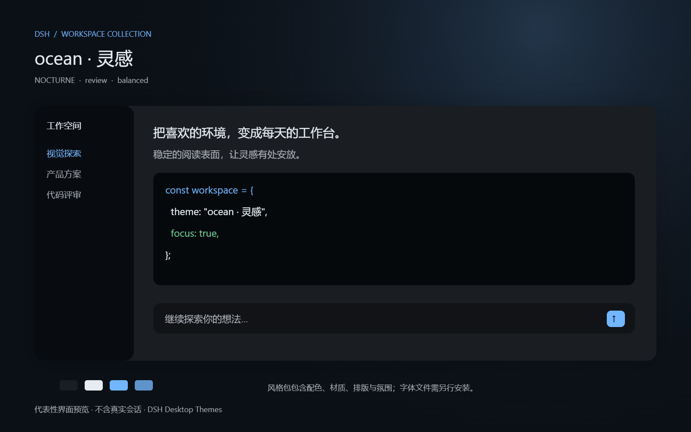

# DSH 工作环境 · 3.0

这次改版将默认入口从参数设置改为成品风格。三套风格是纸感工作室、矿物工作台、夜幕工作室；原有六套配色、个人壁纸与主题库继续兼容。

## 使用路径

1. 设置 → 桌面外观 → 风格与模式：选择成品风格，立即应用，可撤销上次调整。按住空格临时预览、松开或移走焦点恢复。
2. 独立选择创作、专注、评审、演示；模式保留当前配色、字体家族、个人壁纸与伙伴开关。
3. 安静、平衡、沉浸控制整体装饰配方。专注与评审暂停动态装饰并暂时隐藏伙伴，不修改伙伴偏好。
4. 打开工作室：快速调整用于模式、氛围、冷暖、层次、字体和强调色；专业编辑保留七色、OKLCH、协调配色和可读性修复。
5. 所有工作室编辑先留在草稿。顶部“保存并应用”保存；“另存为新主题”创建副本。内置主题不可覆盖。

## 三个互相独立的维度

| 维度 | 作用 | 不会改变 |
| --- | --- | --- |
| 风格 | 主题、材质、环境光、内置壁纸配方 | 字体家族、个人壁纸、模式、伙伴偏好 |
| 工作模式 | 字号、行高、内容宽度 token、装饰收敛 | 主题与个人资产 |
| 氛围 | 壁纸强度、玻璃与粒子配方 | 主题与字体家族 |

模式字号采用明确配方：创作/专注/评审 14px、代码 13px；演示 17px、代码 15px。纸感行高 1.75，其他 1.6。模式会覆盖这些排版参数，字体家族保留。

## 可信预览

工作室提供会话与代码、长文与表格、代码评审、菜单与状态四组固定样例，不读取真实会话。预览使用实际主题 token、语法色、字体栈、字号和壁纸资源。精选风格卡使用由同一个预览组件截取的真实界面缩略图。

“在宿主中试用 20 秒”通过真实客户端的 preview 路径临时注册草稿主题，不排队持久化。20 秒后、Esc、离开工作室或手动结束试用都会恢复。试用中点击保存会先恢复基线，再走正常 commit；临时主题 id 不进入配置快照。

A/B 对比同时保留选定起点的配色与环境基线。专业调色支持 20 步撤销/重做。快速环境参数独立于调色历史；设置页提供上次环境操作的撤销。

## 壁纸生成风格

在工作室选择本地 PNG、JPEG、WebP 或 GIF（最多 25 MB）。图片在本机缩至 96×96，以量化和饱和度权重提取主色相，构建背景、面板、正文、强调色与光影。生成结果通过实际派生表面的可读性检查后进入草稿；原图暂存 IndexedDB，保存后应用。

这是本地确定性算法，无云端上传。透明图片没有可用像素、格式错误、超限或存储失败会显示原因。放弃草稿时清理该草稿新增但未应用的壁纸。

## 风格包、单主题、全部备份

三个层次有不同用途：

- **完整风格包**：`.dsh-style.json`，包含当前草稿配色、语法/ANSI、排版、材质、氛围与当前壁纸。个人壁纸内嵌；内置壁纸保存稳定 id。导入先预览，点击“安装此风格包”后保存为新的自定义主题。保留接收方其他主题、伙伴、性能与最近壁纸偏好。
- **单主题互通**：工作室折叠区支持 DSH / VS Code / Base16 / Base24 / iTerm / shadcn。只交换主题色及该格式支持的元数据。
- **全部设置备份**：设置页顶部统一导出；备份与重置页提供恢复入口。JSON 备份不包含壁纸二进制，跨机器分享带壁纸效果应使用完整风格包。

完整风格包上限 38 MB，壁纸只接受内嵌的受支持图片，不加载远程引用。字体文件不随包分发；接收方可在字体设置下载或使用回退字体。

“导出预览卡 PNG”生成 1600×1000 的代表性界面卡，标明不含真实会话。该卡是可分享的主题展示图，不是当前桌面窗口的截图。

## 精选社区配色

工作室提供 Catppuccin Mocha、Nord、Rosé Pine 三套离线 Base16 适配。保留作者与源链接，必要时调整颜色以通过 DSH 表面的可读性检查。并非原作者官方移植；来源、修改说明和 MIT 许可见 [第三方声明](../THIRD_PARTY_NOTICES.md)。

## 宿主覆盖范围

| 能力 | 当前覆盖 |
| --- | --- |
| 主题、侧栏、输入区、代码与 Diff 语义色 | 通过官方 theme / overrideTokens 应用 |
| 界面/代码字体与字号 | 官方字体 token 及已有字体覆盖层 |
| 壁纸与装饰层 | 插件拥有的可释放样式与 Canvas |
| 纸纹、完整容器造型、毛玻璃、空间层次 | 插件设置和工作室自有表面；不承诺覆盖全部宿主布局 |
| 内容宽度、圆角 | 插件自有表面和 token；宿主未消费的区域不会改变 |
| 终端 ANSI | 预览与导出；没有虚构宿主终端接口 |

默认不启动持续装饰动画，新用户默认关闭桌宠，已有配置中的桌宠开关保留。降低动态效果与降低透明度的系统偏好优先。

## 验收与设计依据

`npm test`、`npm run typecheck`、`npm run audit`、`npm run build`、`npm run test:studio-browser`。

浏览器验收包括六套主题 × 两档桌面截图、390/768/1024 窄窗口、四类内容样例、调色撤销与 A/B、真实客户端入口的配置写入、试用不持久化与恢复、从图片生成配色、携带图片的风格包迁移和 PNG 下载。宿主服务由测试适配器模拟，因此不能把该验收等同于实际 Electron 版本的全部页面验证。

参考 [Linear 2026 界面更新](https://linear.app/now/behind-the-latest-design-refresh)的注意力层级和减少无效分隔，以及 [Warp 自定义主题](https://docs.warp.dev/terminal/appearance/custom-themes/)的可迁移配色和预览。具体材质与三套风格为本项目实现。

不采集用户行为。正式用户验收建议记录首次选到满意风格的耗时、预览与实际差异、长期阅读满意度和主动分享意愿；当前不宣称已经取得这些用户指标。
